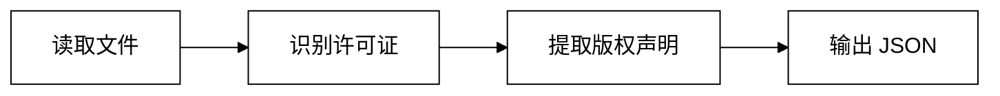

# zh-report-humanizer

一个用于 [Claude Code](https://claude.com/claude-code) / Claude Agent Skills 的技能包，帮助撰写或修改**中文技术 / 学术报告**（课程作业、实验报告、分析报告、课程设计）时去掉"AI 味"，覆盖正文和图表，并附带一个可以单独运行的自检脚本。

A Claude skill for de-AI-ifying Chinese technical/academic reports. It favors concrete details and the real troubleshooting process over stylistic tricks, and ships with a dependency-free Python self-check script.

## 核心主张

报告读起来像人写的，主要取决于内容。这里的内容指两点：

1. **具体性**：关键数字、文件名、命令、报错原文、观察到的现象。
2. **真实过程**：遇到的问题、当时的误判、怎么排查出来的。

这两点做到了，语言保持平实即可，不需要再修饰。因此这个技能同时反对两个方向的改法：

| 方向 | 典型写法 | 问题 |
|---|---|---|
| AI 腔（没改） | 「随着…的不断发展」开头、「全面、系统、深入」三连排比、「充分体现了…的重要价值」 | 套话、排比和意义拔高，删掉也不损失信息 |
| 刻意风格化（改过头） | 「这个坑比前两个值钱」「很慢。」「说实话」 | 文风表演，换了一种 AI 味，学生报告不这么写 |

很多"去 AI 味"提示词会把文本往第二个方向推：加口语、加金句、故意长短句交替。这个技能明确禁止这样做。

## 四条硬规则

其他建议可以按情况权衡，这四条没有例外：

1. **禁止否定与肯定对举**：同一句话里不同时写"是什么"和"不是什么"。先否定再肯定（「不是…而是…」「并非…而是…」）和先肯定再否定（「A 而不是 B」「来自 A，不来自 B」）都禁止。只写肯定，或只写否定。
2. **正文陈述过程不用箭头**：「A → B → C」改用关联词（先…，再…，最后…）或顿号。代码块和行内代码里的箭头不受限制。
3. **全文如非必要不用破折号「——」**：改成逗号、括号、冒号，或拆成两句。
4. **正文和图里不用 emoji 与装饰符号**：✅ ❌ 🚀 💡 一类。

## 效果示例

### 例 1：实验报告的结果分析

改前，一份 AI 初稿（[examples/before.md](examples/before.md)）：

> ### 4. 实验结果与分析
>
> 随着深度学习技术的不断发展，数据增强已成为提升模型泛化能力的重要手段。本节将从准确率、过拟合程度和训练开销三个维度，对实验结果进行全面、系统、深入的分析。
>
> **4.1 准确率**
>
> 加入数据增强后，ResNet-18 在 CIFAR-10 测试集上的准确率从 88.4% 提升至 93.1%，提升了 4.7 个百分点——这一提升并非来自模型容量的增加，而是来自训练数据分布的扩展。数据决定了模型的上限，算法只是在逼近这个上限。
>
> **4.2 过拟合：从死记硬背到举一反三**
>
> 数据增强的作用在于约束模型，而不在于让模型记住更多样本。基线模型训练集准确率高达 99.6%，测试集仅为 88.4%，差距达 11.2 个百分点；加入数据增强后，训练集准确率为 97.4%，测试集为 93.1%，差距缩小至 4.3 个百分点，过拟合问题得到有效缓解。
>
> **4.3 训练开销**
>
> 两组实验的训练流程均为：数据加载 → 随机裁剪与翻转 → 归一化 → 前向传播 → 反向传播，其中基线模型跳过随机裁剪与翻转。增强模型在第 82 轮达到最佳（基线为第 35 轮），训练时间从 41 分钟增加到 97 分钟——这是为获得更强泛化能力所付出的合理代价。慢一点，是为了走得更远。
>
> **4.4 小结**
>
> 数据增强不仅显著提升了模型的准确率，更有效缓解了过拟合问题，充分体现了其在图像分类任务中的重要价值，可以作为图像分类任务的标准配置。好的模型不只是算出来的，更是"喂"出来的。

改后（[examples/after.md](examples/after.md)）：

> ### 4. 实验结果与分析
>
> 两组模型的结果见表 4-1。
>
> 表 4-1 有无数据增强的结果对比
>
> | 指标 | 基线 | 数据增强 |
> |---|---:|---:|
> | 测试集准确率 / % | 88.4 | 93.1 |
> | 训练集准确率 / % | 99.6 | 97.4 |
> | 达到最佳的轮数 | 35 | 82 |
> | 训练时间 / min | 41 | 97 |
>
> **4.1 准确率与过拟合**
>
> 加入数据增强后，测试集准确率提高了 4.7 个百分点。两组模型的参数量相同，训练时都要加载数据、归一化，再做前向传播和反向传播；增强模型只是在归一化之前多做了随机裁剪和翻转。因此准确率的提高来自训练数据分布的扩展。
>
> 训练集和测试集之间的差距从 11.2 个百分点缩小到 4.3 个百分点，说明过拟合明显减轻。
>
> **4.2 训练开销**
>
> 数据增强的代价是收敛变慢。增强模型到第 82 轮才达到最佳，训练时间是基线的两倍多。
>
> **4.3 结论**
>
> 在本实验的设置下，数据增强在不增加参数的情况下减轻了过拟合，代价是训练时间增加到两倍多。实验只测试了 ResNet-18 和 CIFAR-10 这一组组合，换成其他模型和数据集时，这个结论还需要另外验证。

改写稿里的数字都来自初稿，没有添加新信息。具体改了这些地方：

| 位置 | 初稿的问题 | 改法 |
|---|---|---|
| 开头段 | 「随着…的不断发展」套话开头，「本节将从三个维度…」预告，「全面、系统、深入」三连排比 | 整段删掉，直接给出结果表 |
| 4.1 | 「并非来自模型容量的增加，而是来自训练数据分布的扩展」，先否定再肯定（硬规则一） | 只写肯定，并补上依据：两组参数量相同，只差数据增强这一步 |
| 4.2 | 「作用在于约束模型，而不在于让模型记住更多样本」，先肯定再否定（硬规则一） | 整句删掉，它的意思已经由后面的数据表达 |
| 4.3 | 「数据加载 → 随机裁剪与翻转 → …」（硬规则二） | 改成关联词：先加载数据、归一化，再做前向传播和反向传播 |
| 4.1、4.3 | 两处破折号，一处引出对举，一处引出评价「合理代价」（硬规则三） | 破折号连同后面的评价一起删掉 |
| 全文 | 正文里堆了十几个数字，一句话最多四个 | 全量数据进表 4-1，正文只写变化（提高 4.7 个百分点、两倍多） |
| 4.1、4.2 标题、4.3、小结 | 四处金句：「数据决定了模型的上限…」「从死记硬背到举一反三」「慢一点，是为了走得更远」「好的模型不只是算出来的，更是"喂"出来的」 | 全部删掉，标题改成描述性的「准确率与过拟合」。金句只有态度，没有能核对的信息 |
| 小结 | 「不仅…更…」「充分体现了…重要价值」，结论推广到"标准配置" | 只写本实验里成立的结论，并写明它的适用范围 |

### 例 2：改过头也是问题

下面左列是常见的"去 AI 味"产物，读起来像公众号推文。技能会把它们改回平实写法。

| 刻意风格化（不要写） | 平实写法 |
|---|---|
| 这个坑比前两个值钱 | 这个问题的影响比前两个大 |
| 麻烦的地方在于退出码是 0 | 这次扫描的退出码是 0 |
| 结论的适用范围比看上去窄 | 这个结论有两个限制 |
| 真正耗时间的是第一步。很慢。 | 整个过程用时约 124 秒，其中扫描本身占 120 秒。 |
| 人味来自写了什么，不来自怎么写 | 报告读起来像人写的，主要取决于内容。 |

### 例 3：图

改前，AI 常见画法：胶囊形和圆角节点、彩色填充、emoji，图题是评价。

````text

图 1 智能高效的扫描流程
````

改后：黑白直角预设，图题是描述性短语，正文先引用再出图。

````text
处理流程如图 2-1 所示，先读取文件，再识别许可证，然后提取版权声明，最后输出 JSON。


图 2-1 ScanCode 扫描流程
````

PlantUML、Graphviz、matplotlib、draw.io 的黑白预设见 [references/figures-zh.md](references/figures-zh.md)。

### 自检脚本对比

对例 1 的两份文件运行 `python scripts/check_report.py`：

| 检查项 | before.md | after.md |
|---|---:|---:|
| 硬规则一：先否定再肯定 | 2 | 0 |
| 硬规则一：先肯定再否定 | 1 | 0 |
| 硬规则二：箭头 | 1 | 0 |
| 硬规则三：破折号 | 2 | 0 |
| 套话短语 | 1 | 0 |
| 句法层特征（体现了） | 1 | 0 |
| 提示项：数字过密的句子 | 1 | 0 |
| **退出码** | **1** | **0** |

脚本只能抓到有固定字面特征的问题。初稿里的预告句、「全面、系统、深入」三连排比、四处金句（最后一句因为同时是「不只是…更是…」对举才被报出）、越界的结论，脚本没有报出来，这些靠 SKILL.md 里的规则让 Claude 改写。

## 仓库结构

```text
zh-report-humanizer/
├── SKILL.md                     # 技能主文件：硬规则、语体基线、数据写法、负向词表、改写手法、图表与排版
├── references/
│   ├── ai-tells-zh.md           # AI 写作特征完整清单（内容层、语言层、结构层、图表层）
│   ├── figures-zh.md            # 图表规范与 Mermaid / PlantUML / Graphviz / matplotlib / draw.io 黑白预设
│   └── rewrite-examples.md      # 13 组改写范例
├── scripts/
│   └── check_report.py          # 自检脚本（纯标准库，Python 3.8+）
└── examples/
    ├── before.md                # 例 1 的 AI 初稿
    └── after.md                 # 例 1 的改写稿
```

## 安装

把整个目录放到 Claude Code 的 skills 目录下：

```bash
# 个人级（所有项目可用）
git clone https://github.com/Red-Sa1t/zh-report-humanizer ~/.claude/skills/zh-report-humanizer

# 项目级（只对当前仓库生效）
git clone https://github.com/Red-Sa1t/zh-report-humanizer .claude/skills/zh-report-humanizer
```

Windows 下个人级目录是 `%USERPROFILE%\.claude\skills\`。

安装后，在对话里说「帮我去掉这篇报告的 AI 味」「报告润色」「写得自然点」「图太花了」等，Claude 会自动加载这个技能。

写调试、排错这类内容时，请把报错原文、命令输出和当时的判断一起交给 Claude。这个技能要求不编造没有发生过的过程。

## 单独使用自检脚本

脚本不依赖第三方库，可以脱离 Claude 单独用：

```bash
python scripts/check_report.py report.md
python scripts/check_report.py examples/before.md examples/after.md
```

检查内容包括四条硬规则、禁用词和套话、图题表题位置与正文引用、画图代码里的彩色圆角阴影、中英文混排空格、中文里的半角标点、人称混用，以及流水句、可能性表述、数字过密句子这几类提示项。硬规则有命中时退出码为 1，可以放进 pre-commit 或 CI。

## 适用范围与局限

- 面向正式书面报告。公众号、博客、小说这类需要文风的文体不适用。
- 规则检查基于正则，会有误报和漏报。脚本输出是候选清单，最终以人工判断为准。
- 这个技能的目标是把报告写清楚、写具体。它没有规避 AIGC 检测或学术诚信审查的用途。没做过的实验、没踩过的坑不要编，参考文献必须逐条核实。

## 参考

- Wikipedia: [Signs of AI writing](https://en.wikipedia.org/wiki/Wikipedia:Signs_of_AI_writing)
- GB/T 7713、GB/T 7714-2015

## 许可证

[MIT](LICENSE)。欢迎提 Issue 或 PR 补充词表、误报样例和改写范例。
