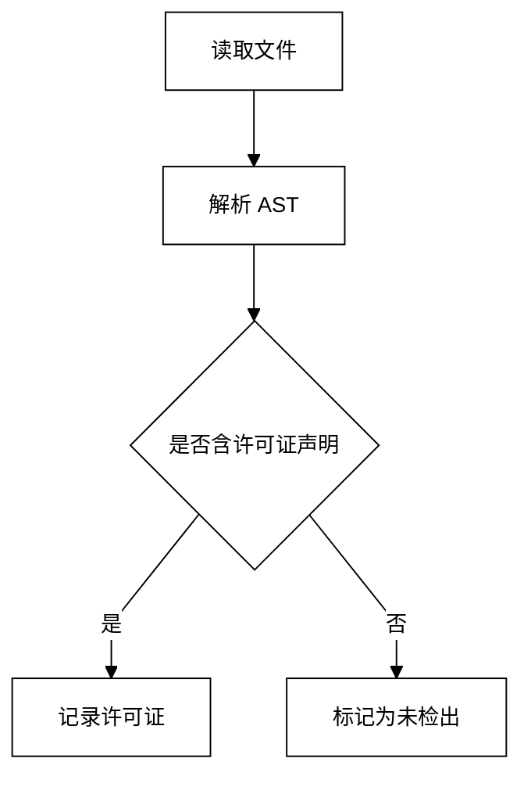

# 报告图表规范

本文件管报告里的图、表、截图。课程或学校发了模板的，**以模板为准**，本文件只补模板没写到的部分。

编号和图题表题位置参照 GB/T 7713 系列（科技报告、学位论文、学术论文编写规则）和国内多数高校的论文模板惯例。

## 一、为什么图也有 AI 味

AI 生成的图有一组很稳定的特征：彩色填充、圆角矩形、阴影、渐变、图标和 emoji、图内自带大标题、配色像 PPT 模板。这些在打印成黑白之后要么看不清，要么显得像宣传材料。

报告图的标准只有一条：**黑白打印后信息不丢，读者一眼看清结构。**

## 二、样式

| 项目 | 要求 | 不要 |
|---|---|---|
| 框 | 直角矩形，黑色细实线（约 0.5 到 1 pt），白色填充 | 圆角、胶囊形、彩色填充、渐变、阴影、3D |
| 判断节点 | 菱形 | 用颜色区分判断和步骤 |
| 连线 | 黑色实线带箭头；可选流程用虚线 | 彩色线、粗线、曲线乱绕 |
| 文字 | 宋体或黑体，字号与正文接近（五号或小五）；英文和代码用等宽或 Times New Roman | 手写体、艺术字、图内字号比正文大很多 |
| 颜色 | 默认黑白灰。数据系列用线型（实线、虚线、点划线）、标记（圆、方、三角）或填充纹理区分 | 只靠颜色区分系列；彩虹色 colormap |
| 装饰 | 无 | emoji、图标库小图标、背景图、水印 |
| 图内标题 | 不写，标题放到图题里 | 图片顶部一个大标题，下面又有图题 |

**确实需要颜色时**（热力图、课程明确要求彩图）：用单色渐变（灰度或单一色相），并保证换成灰度后仍能区分。

## 三、编号、图题、表题

1. **位置**：图题在图的**下方**，表题在表的**上方**。
2. **编号**：按章编号，如「图 2-1」「表 3-2」；短报告也可以全文连续编号「图 1」「图 2」。全文统一一种。
3. **图题写法**：描述性短语，说清图里是什么。
   - 合格：「图 3-1 ScanCode 扫描流程」「图 4-2 不同线程数下的扫描耗时」
   - 不合格：「图 3-1 高效稳定的扫描架构」（评价）、「图 4-2 线程越多越快」（结论句）
4. **先引用，后出现**：正文先写「如图 3-1 所示」或「扫描耗时见表 4-1」，图表放在引用它的段落之后。没有被正文引用的图，说明它和论述无关，删掉。
5. **图下要有解读**：图后至少一句话说明读者该看什么，例如「8 线程之后耗时基本不再下降」。只贴图不解释，等于把分析交给读者。
6. **来源**：引用别人的图，在图题后注明出处。

## 四、表格

- 用**三线表**：顶线、栏目线、底线三条横线，不要竖线，不要每行都画横线。
- 单位写在表头里，如「耗时 / s」「大小 / KB」，单元格里只写数字。
- 同一列的数字小数位数统一，按小数点或右对齐。
- 空值用「—」或「无」，全表统一。
- 表格只承载数据和逐项对比。要讲推理过程，用正文。

Markdown 里画不出三线表；最终导出 Word 时，在 Word 里把表格样式改成三线表，或用 pandoc 的参考文档模板。

## 五、截图

- 只截相关区域，不带整个桌面、任务栏、浏览器标签页。
- 要指出某个位置时，用细的矩形框标出，不用大红箭头和手绘圈。
- 命令和终端输出优先直接贴成代码块文本；截图只用于界面结果。文本能复制、能搜索，也不会糊。
- 截图里的个人信息（用户名、路径里的真名、token）先打码。

## 六、各工具的黑白直角预设

直接复制到画图代码开头。

### Mermaid



节点形状：普通步骤用 `id[文字]`（直角矩形），判断用 `id{文字}`（菱形）。不要用 `id(文字)`（圆角）、`id([文字])`（胶囊）、`id((文字))`（圆形）。

### PlantUML

```plantuml
@startuml
skinparam monochrome true
skinparam shadowing false
skinparam roundcorner 0
skinparam defaultFontName SimSun
skinparam handwritten false
@enduml
```

### Graphviz

```dot
digraph G {
  graph [splines=ortho, nodesep=0.5];
  node  [shape=box, style=solid, color=black, fontname="SimSun", fontsize=12];
  edge  [color=black, arrowsize=0.7];
}
```

### matplotlib

```python
import matplotlib.pyplot as plt

plt.rcParams.update({
    "font.sans-serif": ["SimSun", "SimHei"],   # 中文字体
    "axes.unicode_minus": False,               # 负号正常显示
    "font.size": 10.5,                         # 约等于五号字
})

fig, ax = plt.subplots(figsize=(5, 3.2))
ax.plot(threads, t_a, color="black", linestyle="-",  marker="o", label="方案 A")
ax.plot(threads, t_b, color="black", linestyle="--", marker="s", label="方案 B")
ax.set_xlabel("线程数")
ax.set_ylabel("耗时 / s")
ax.legend(frameon=False)
# 不写 ax.set_title，标题放到正文的图题里
fig.savefig("fig4-2.png", dpi=300, bbox_inches="tight")
```

柱状图用 `color="white", edgecolor="black", hatch="//"` 区分系列。

### draw.io / Visio 等手动画图工具

选中全部图形后统一设置：填充白色，线条黑色，线宽 1 pt，关闭「圆角」和「阴影」，字体宋体。draw.io 的样式字符串可以直接粘贴：

```text
rounded=0;whiteSpace=wrap;html=1;fillColor=#ffffff;strokeColor=#000000;shadow=0;fontFamily=SimSun;
```

## 七、改写范例

**改前（AI 常见画法）：**


图题写成「图 1 智能高效的扫描流程」。

问题：胶囊形和圆角节点、彩色填充、emoji，图题是评价。

**改后：** 用第六节的 Mermaid 预设，节点全部改成 `id[文字]`，删掉 `style` 行和 emoji，图题改成「图 3-1 ScanCode 扫描流程」，图前写「扫描流程如图 3-1 所示」，图后补一句「其中识别许可证这一步占总耗时的 97%」。

## 八、自检

`check_report.py` 会检查：图片和画图代码块下方有没有图题、表格上方有没有表题、图表编号有没有在正文里被引用、Mermaid / PlantUML / Graphviz / matplotlib 代码有没有用彩色、圆角、阴影、图内标题。图片本身的内容（比如 PNG 里画的是不是圆角）脚本看不到，需要人工看一遍。
